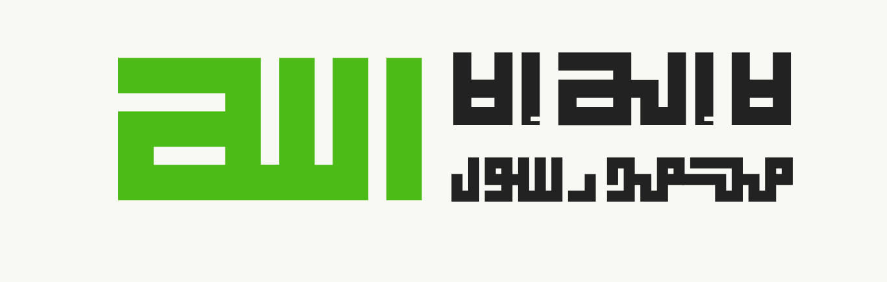

<table>
<tr>
<td width="50%" valign="top" dir="ltr">

**Full-Stack Developer**

I'm **Mohamed** , **15** years old, a software developer. I build clean, reusable Node.js packages and libraries, full-stack applications from the UI down to the database, and mobile apps. I write readable, maintainable code and break complex problems into small pieces to solve them at the root.

### What I Build

- Node.js packages and libraries with clear APIs
- Full-stack web applications
- Mobile apps with React Native

### Backend

- Designing REST and GraphQL APIs
- Authentication and authorization (JWT, OAuth)
- Data modeling and query optimization
- Caching and background job queues
- Real-time communication with WebSockets
- Testing, Docker deployment and CI/CD

</td>
<td width="50%" valign="top" dir="rtl">

**مطوّر Full-Stack**

أنا **محمد** ، عمري **15** سنة، مطوّر برمجيات. أبني حزم ومكتبات Node.js نظيفة وقابلة لإعادة الاستخدام، وتطبيقات متكاملة من الواجهة حتى قاعدة البيانات، وتطبيقات موبايل. أكتب كوداً مقروءاً وسهل الصيانة، وأفكّك المشاكل المعقدة إلى أجزاء بسيطة وأحلّها من جذورها.

### ماذا أبني؟

- حزم ومكتبات Node.js بواجهات برمجية واضحة
- تطبيقات ويب متكاملة
- تطبيقات موبايل بـ React Native
- احب التمر :)
### الباك إند

- تصميم واجهات REST وGraphQL
- المصادقة والصلاحيات (JWT وOAuth)
- نمذجة البيانات وتحسين الاستعلامات
- التخزين المؤقت وطوابير المهام
- الاتصال اللحظي عبر WebSockets
- الاختبارات والنشر عبر Docker وCI/CD

</td>
</tr>
</table>

---

### Languages

  

### Backend Stack

  

### Databases

  

### Frontend & Mobile

  

### DevOps & Tools

  

### Code Review

  

### Connect

  
  

